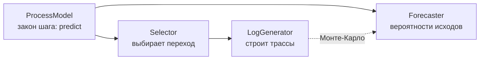

# Базовые классы survpm: закон шага, Selector, LogGenerator, Forecaster

Модель описывает только закон одного шага. Выбор перехода, цикл генерации и прогноз — отдельные компоненты, которые обращаются к этому закону.



- `ProcessModel` говорит, куда и через сколько можно перейти из состояния.
- `Selector` выбирает один из этих переходов.
- `LogGenerator` повторяет выбор шаг за шагом и собирает журнал.
- `Forecaster` считает вероятности исходов: по модели формулой или по многим трассам генератора.

## Сценарий использования

```python
# 1. Данные
log = EventLog.read("sepsis.csv").prepare(starts=["Registration"], terminals=["Release A", "Release B"])
train, test = log.split(seed=1)

# 2. Модель: сеть + закон шага, обучение по train с учётом цензуры
model = ProcessModel().fit(train, features=["Age", "CRP", "history_visits"])
model.predict(state="Admission", X={"Age": 70, "CRP": 120})   # один шаг: куда и через сколько

# 3. Генерация журнала (синтетика той же структуры, что train)
gen = ModelGenerator(model, cases=start_like(train), selector=SampleSelector(),
                     censoring=StudyEnd(days=90), seed=1)      # подкласс LogGenerator, генерирует по обученной модели
synthetic = gen.generate()                                     # EventLog, один прогон
paths = synthetic.traces()                                     # трассы того же прогона

# 4. Прогноз для реального пациента на момент as_of
MarkovForecaster(model).terminal_probs(test, as_of=t, times=[1, 7, 30], case_id="c42")   # F_k(t) формулой, подкласс Forecaster, вызыывает model.predict
SimulationForecaster(model, n_paths=1000).survival(test, as_of=t, times=[1, 7, 30], case_id="c42")  # Монте-Карло, подкласс Forecaster, вызыввает ModelGenerator

# 5. Сценарии продолжения для того же пациента
case = snapshot(test, case_id="c42", as_of=t)                 # история только до as_of
ModelGenerator.from_case(model, case, selector=BestSelector(target="Release A")).generate()   #подкласс LogGenerator, генерирует новый журнал и трассы по правилу перехода, которые выбирает в selector=
ModelGenerator.from_case(model, case, selector=WorstSelector(target="Release A")).generate()

# 6. Проверка на синтетике с известной истиной
truth = ChoiceThenTimeModel(AD_EDGES)                          # заданный закон шага
data = ModelGenerator(truth, cases=start(n=1000, state="A"),
                      censoring=RandomLoss(mean_days=60) + StudyEnd(days=90), seed=2).generate()
fitted = ProcessModel().fit(data)
compare(fitted, truth, data)                                   # метрики: восстановили ли истину
```

## Закон шага: `model.predict`

```python
model.predict(state, X) -> StepDistribution
```

`StepDistribution` описывает один шаг из `state` при признаках `X`: выходы `dst`, их вероятности `p_d`, распределение времени ожидания, `sample(rng)`, `mean_time`, интенсивности `hazard_d(t)`. Реализации закона:

- `ExponentialTransitionModel` — конкурирующие экспоненты, обучается по журналу;
- `ChoiceThenTimeModel(edges)` — заданная истина: выход по `p`, время из `dist` (синтетика A–D).

## Selector: выбор перехода

```python
class Selector(ABC):
    @abstractmethod
    def select(self, case, step: StepDistribution, rng) -> Step: ...
```

- `SampleSelector` — честный розыгрыш по закону (по умолчанию);
- `MostLikelySelector` — выход с наибольшим `p_d`, ожидаемое время;
- `BestSelector`, `WorstSelector` — выход с наибольшей (наименьшей) вероятностью заданного исхода; смотрят вперёд через `Forecaster`.

Selector выбирает одно продолжение и нужен только генерации. Прогнозу он не нужен: прогноз суммирует все продолжения.

## LogGenerator: генерация журнала

```python
class LogGenerator(ABC):
    terminals: set

    def __init__(self, seed=None, horizon=None, max_steps=1000, censoring=None): ...

    # обязательно
    @abstractmethod
    def start_cases(self, n, rng) -> Iterable[Case]: ...    # начальные объекты
    @abstractmethod
    def next_step(self, case, rng) -> Step | None: ...     # следующий переход из текущего состояния

    # необязательно
    def on_enter(self, case, rng) -> dict: ...             # признаки X на входе в состояние

    # реализовано в базовом классе
    def generate(self, n=None) -> EventLog: ...           # один прогон: журнал + таблица наблюдения + трассы
```

`Step(dst, dt)` — переход в `dst` через `dt` дней; `Step(None, dt, "lost")` — обрыв наблюдения; `None` — выхода нет. Базовый класс ведёт цикл до терминала, горизонта или `max_steps`, даёт каждому объекту свой поток случайных чисел по `case_id`, применяет `Censoring` и собирает `EventLog` с таблицей `end, event, reason`.

Трассы и журнал получаются из одной симуляции. Отдельного `traces()` у генератора нет: трассы читаются из того же журнала через `log.traces()` → `[(состояния, дни от старта)]`. Поэтому они всегда совпадают с журналом, и тот же метод работает для реального журнала (Sepsis).

Основная реализация — `ModelGenerator(model, cases, selector=SampleSelector(), censoring=None)`: `next_step = selector.select(case, model.predict(case.state, case.X), rng)`. Синтетика с известной истиной — тот же `ModelGenerator` с `ChoiceThenTimeModel`. Продолжение реального объекта — `ModelGenerator.from_case(model, snapshot(log, case_id, as_of), selector=...)`.

`Censoring` — отдельный компонент: конец исследования, случайная потеря наблюдения или свой закон. Подключается к любому генератору.

## Forecaster: прогноз для наблюдаемого объекта

```latex
F_k(t) = P\left(T \le t,\ \text{исход} = k \mid \mathcal{H}_{\text{as\_of}}\right)
```

```python
class Forecaster(ABC):
    def __init__(self, terminals, history_features=None): ...

    # обязательно
    @abstractmethod
    def cumulative_incidence(self, case, times) -> pd.DataFrame: ...  # horizon, outcome, cdf

    # реализовано в базовом классе (можно переопределить)
    def terminal_probs(self, log, as_of, times, case_id=None): ...
    def survival(self, log, as_of, times, case_id=None): ...
    def hazard(self, log, as_of, times, case_id=None): ...
    def expected_time(self, log, as_of, horizon, case_id=None): ...
```

Базовый класс строит `Case` через `snapshot(log, case_id, as_of)` (история только до as\_of), проверяет ответ (0 ≤ F\_k ≤ 1, F\_k не убывает, Σ\_k F\_k ≤ 1) и выводит остальное по тождествам конкурирующих рисков:

```latex
S(t) = 1 - \sum_k F_k(t), \qquad
h_k(a,b] = \frac{F_k(b) - F_k(a)}{S(a)\,(b-a)}, \qquad
\mathrm{RMST}(h) = \int_0^h S(t)\,dt
```

| Реализация | Метод | Точность |
| --- | --- | --- |
| `MarkovForecaster` | F\_k(t) = [exp(Q t)]\_{s,k} по интенсивностям из `predict` | точно для экспоненциального закона при X, фиксированных после as\_of |
| `GridForecaster` | уравнение марковского восстановления на сетке по плотностям из `predict` | O(h²) |
| `SimulationForecaster` | доля из n путей `ModelGenerator` с `SampleSelector` | стандартная ошибка √(F(1−F)/n) |

## Объект: `snapshot` и `Case`

Один способ описать объект: `Case(case_id, state, t, X, history, sojourn)`. `snapshot(log, case_id, as_of)` строит его по журналу, обрезанному на as\_of. Им пользуются `Forecaster`, `ModelGenerator.from_case` и поток начальных объектов. Отдельный `Router` не нужен.

## Статус

- Сделано: `LogGenerator`, `ModelGenerator`, `TruthGenerator`, `Forecaster`, `SimulationForecaster`, `MarkovForecaster`.
- План: 1) `model.predict` и `StepDistribution`, `Selector` вместо `picker` внутри модели (`SampleSelector` сохраняет прежние числа); 2) `ChoiceThenTimeModel` вместо `TruthGenerator`, `Censoring`, `EventLog.traces()` вместо `LogGenerator.traces()`; 3) `snapshot`, `ObjectStream` из `Case`, удаление `Router`; 4) `MostLikely`, `Best`, `Worst`, `GridForecaster`.
