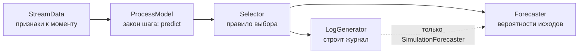

# Базовые классы survpm: StreamData, ProcessModel, Selector, LogGenerator, Forecaster

Базовые классы задают только общий алгоритм: как берутся признаки, как выбирается переход, как считается время. Этот алгоритм не меняется. Вся математика живёт в реализациях, и чтобы сделать свою модификацию, достаточно переопределить один метод одного компонента.



- `StreamData` по журналу даёт таблицу X: где объект сейчас и какие у него признаки.
- `ProcessModel` по X говорит, куда и через сколько можно перейти.
- `Selector` задаёт правило выбора перехода: веса выходов.
- `LogGenerator` повторяет шаг и дописывает журнал.
- `Forecaster` считает вероятности исходов по тем же модели и правилу выбора.

## Формат данных

Один формат на входе и на выходе всех компонентов — `EventLog`: события, замеры признаков и таблица наблюдения с обязательной колонкой `end` («объект наблюдали до»). Момент «сейчас» для объекта — его `end`, отдельные параметры `as_of`, `case_id`, `cases`, `censoring` не нужны.

```python
log.cut(t)                          # события до t, end = t (t — дата или Series case_id → дата)
EventLog.start(n=1000, state="A")   # по одному стартовому событию на объект
log.censor(StudyEnd(days=90) + RandomLoss(mean_days=60))   # цензура поверх готового журнала
log.traces()                        # [(состояния, дни от старта)]
```

Таблица X, которую видят модель, Selector и Forecaster, — одна строка на объект:

| case_id | state | elapsed | Age | CRP | history_visits |
| --- | --- | --- | --- | --- | --- |
| c42 | Admission | 1.0 | 70 | 120 | 1 |

`elapsed` — дни в текущем состоянии на момент `end`. Для экспоненциального закона не влияет, для остальных остаток ожидания считается при условии, что за `elapsed` выхода не было.

## Сценарий использования

```python
# 1. Данные
log = EventLog.read("sepsis.csv").prepare(starts=["Registration"], terminals=["Release A", "Release B"])
train, test = log.split(seed=1)

# 2. Модель: обучение по train с учётом цензуры
model = ProcessModel().fit(train, features=["Age", "CRP", "history_visits"])
X = DefaultStreamData().at(test.cut(t))    # таблица: case_id, state, elapsed, признаки; cut — только для проверки на истории
model.predict(X)                           # один шаг для каждой строки: куда и через сколько

# 3. Генерация журнала
gen = ModelGenerator(model, seed=1)        # selector=SampleSelector(), data=StreamData() по умолчанию
synthetic = gen.generate(EventLog.start(n=1000, state="Registration")).censor(StudyEnd(days=90))
paths = synthetic.traces()                 # трассы того же прогона

# 4. Прогноз для реальных пациентов на момент t
now = test.cut(t)
MarkovForecaster(model).terminal_probs(now, times=[1, 7, 30])            # F_k(t) формулой
SimulationForecaster(model, n_paths=1000).survival(now, times=[1, 7, 30])  # Монте-Карло, с se
MarkovForecaster(model, selector=BestSelector(target="Release A")).terminal_probs(now, times=[30])  # если всегда выбирать лучший переход

# 5. Сценарии продолжения тех же пациентов
ModelGenerator(model, selector=BestSelector(target="Release A")).generate(now)
ModelGenerator(model, selector=WorstSelector(target="Release A")).generate(now)

# 6. Проверка на синтетике с известной истиной
truth = ChoiceThenTimeModel(AD_EDGES)      # заданный закон шага
data = ModelGenerator(truth, seed=2).generate(EventLog.start(n=1000, state="A")) \
                                    .censor(RandomLoss(mean_days=60) + StudyEnd(days=90))
compare(ProcessModel().fit(data), truth, data)   # метрики: восстановили ли истину (план)
```

Прогноз и продолжение получают один и тот же вход `test.cut(t)`.

## Общий алгоритм

Цикл генерации записан в базовом `LogGenerator` и не меняется:

```python
while есть незавершённые объекты:
    X    = data.at(log)                    # StreamData: где объект и какие признаки
    step = model.predict(X)                # ProcessModel: куда и через сколько
    move = selector.select(X, step, rng)   # Selector: какой переход
    log  = log.append(move)                # новое событие, end += dt
```

Каждая строка — ровно один компонент. Модификация меняет реализацию одной строки, а не цикл.

## StreamData: признаки к моменту

```python
class StreamData(ABC):
    @abstractmethod
    def at(self, log, **kw) -> pd.DataFrame: ...   # X на момент end каждого объекта
```

`DefaultStreamData` берёт последнее состояние, `elapsed`, последние замеры до `end` и признаки истории (`history_visits`, `history_elapsed_days`). Одна и та же функция работает для реального журнала и внутри генерации. Своя динамика признаков (например, CRP падает после антибиотиков) — своя реализация `at`.

## ProcessModel: закон шага

```python
model.predict(X, **kw) -> StepDistribution
```

Для каждой строки X: выходы `dst`, вероятности `p_d`, распределение времени ожидания при условии `elapsed`, интенсивности `hazard_d(t)`, `sample(rng)`. Реализации:

- `ExponentialTransitionModel` — конкурирующие экспоненты, обучается по журналу;
- `ChoiceThenTimeModel(edges)` — заданная истина: выход по `p`, время из `dist` (синтетика A–D).

## Selector: правило выбора

```python
class Selector(ABC):
    @abstractmethod
    def weights(self, X, step, **kw) -> pd.DataFrame: ...   # case_id, dst, weight (сумма 1)

    # реализовано в базовом классе
    def select(self, X, step, rng, **kw): ...   # dst по weights, время из step для этого dst
```

| Selector | `weights` |
| --- | --- |
| `SampleSelector` (по умолчанию) | p\_d из модели |
| `MostLikelySelector` | 1 у max p\_d |
| `BestSelector`, `WorstSelector` | 1 у выхода с наибольшей (наименьшей) вероятностью исхода по прогнозу на шаг вперёд |
| свой | любые веса, например 0 у запрещённого перехода |

Правило выбора задаётся только весами, поэтому один Selector работает и в генерации (`select`), и в прогнозе (`weights`). Время берётся из закона модели; `SampleSelector(time="mean")` берёт среднее вместо розыгрыша. Если правило не сводится к весам, можно переопределить `select`: тогда оно работает в генерации и `SimulationForecaster`, но не в формульных прогнозах.

## LogGenerator: генерация журнала

```python
class LogGenerator(ABC):
    def __init__(self, data=None, seed=None, **kw): ...   # data: StreamData, по умолчанию DefaultStreamData

    # обязательно
    @abstractmethod
    def step(self, X, rng, **kw) -> pd.DataFrame: ...     # case_id, dst, dt

    # реализовано в базовом классе
    def generate(self, log, max_steps=1000, horizon=None, **kw) -> EventLog: ...   # продолжает каждый объект от его end
```

Базовый класс ведёт общий цикл до терминала или `max_steps`, даёт каждому объекту свой поток случайных чисел по `case_id` и пишет причину остановки в таблицу наблюдения (`end, event, reason`). Трассы и журнал — один прогон: `log.traces()`.

Основная реализация — `ModelGenerator(model, selector=SampleSelector(), data=None, seed=None)`: `step = selector.select(X, model.predict(X), rng)`. Синтетика — тот же `ModelGenerator` с `ChoiceThenTimeModel`. Продолжение реального объекта — `generate(log.cut(t))`. Цензура не зависит от процесса и накладывается на готовый журнал через `log.censor(...)`.

## Forecaster: прогноз

```latex
F_k(t) = P\left(T \le t,\ \text{исход} = k \mid \text{журнал до end}\right)
```

```python
class Forecaster(ABC):
    def __init__(self, model, selector=None, data=None, **kw): ...   # selector: SampleSelector по умолчанию

    # обязательно
    @abstractmethod
    def cumulative_incidence(self, X, times, **kw) -> pd.DataFrame: ...  # case_id, horizon, outcome, cdf

    # реализовано в базовом классе
    def terminal_probs(self, log, times, **kw): ...
    def survival(self, log, times, **kw): ...
    def hazard(self, log, times, **kw): ...
    def expected_time(self, log, horizon, **kw): ...
```

Базовый класс получает `X = data.at(log)`, вызывает `cumulative_incidence`, проверяет ответ (0 ≤ F\_k ≤ 1, F\_k не убывает, Σ\_k F\_k ≤ 1) и выводит остальное по тождествам конкурирующих рисков:

```latex
S(t) = 1 - \sum_k F_k(t), \qquad
h_k(a,b] = \frac{F_k(b) - F_k(a)}{S(a)\,(b-a)}, \qquad
\mathrm{RMST}(h) = \int_0^h S(t)\,dt
```

Все методы возвращают таблицу: одна строка на объект и горизонт. `times` — дни от `end` объекта.

| Реализация | Метод | Что использует | Точность |
| --- | --- | --- | --- |
| `MarkovForecaster` | F\_k(t) = [exp(Q t)]\_{s,k}, строка Q = Λ·w\_d | `predict`, `weights` | точно для экспоненциального закона при X, фиксированных после end |
| `GridForecaster` | уравнение марковского восстановления на сетке | `predict`, `weights` | O(h²) |
| `SimulationForecaster` | доля из n путей `ModelGenerator` | `predict`, `select`, `StreamData` на каждом шаге | стандартная ошибка √(F(1−F)/n) |

## Статус

- Сделано 25.11 (survpm 0.3.0): `EventLog.cut`, `EventLog.start`, `log.censor` (`StudyEnd`, `RandomLoss`), `log.traces`; `StreamData`, `DefaultStreamData`; `model.predict(X)` и `StepDistribution` (`ExponentialStep`, `ChoiceThenTimeStep`, `SampledStep`), `ChoiceThenTimeModel`; `Selector` с `weights` (`SampleSelector`, `MostLikelySelector`, `BestSelector`, `WorstSelector`); `LogGenerator.step`/`generate(log)`, `ModelGenerator`; `Forecaster` на журнале и X с `selector`: `MarkovForecaster`, `GridForecaster`, `SimulationForecaster`.
- Сделано 26.11: все ноутбуки переведены на новый интерфейс; прежний движок (`ObjectStream`, `Simulator`, `Router`, `FeatureUpdater`, вызовы с `as_of`, модули `legacy_generation`, `legacy_forecasting`) удалён из survpm и лежит в `archive/survpm_legacy_interfaces_2026-11-26`. Добавлен `log.starts(prefix)` — те же объекты с начала (замена `ObjectStream.from_log`).
- План: `compare(fitted, truth, data)`.
