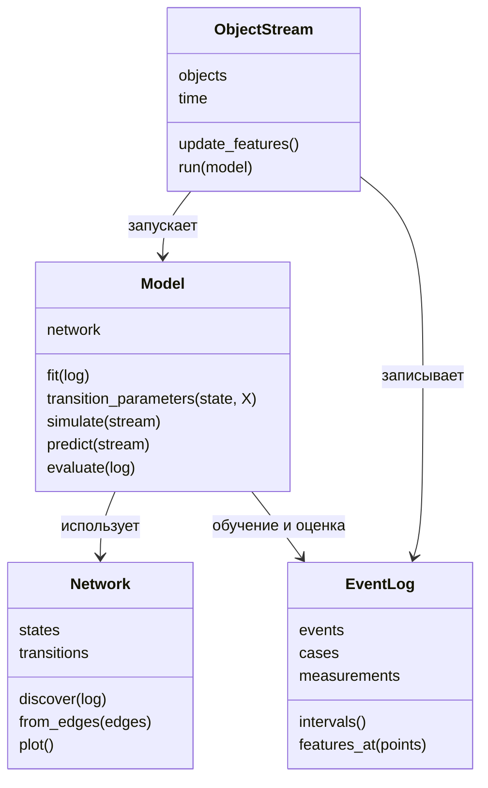

# ООП-архитектура survpm

Архитектура состоит из четырёх основных классов: **сеть**, **модель**, **журнал** и **поток объектов**. Распределения, функции признаков, алгоритмы discovery, визуализации и метрик подключаются как функции или внешние модели. Таблицы данных и результатов — `pandas.DataFrame`.



## 1. Network — сеть процесса

Хранит состояния, допустимые переходы, начальные и конечные состояния. Структура отделена от вероятностей и распределений: одна сеть может использоваться несколькими моделями и профилями поведения. Допускаются циклы, повторные события и несколько исходов.

| Метод | Вход → выход |
|---|---|
| `Network.from_edges(edges, starts, terminals)` | Таблица рёбер, начальные и конечные состояния → сеть. |
| `Network.discover(log, method, **options)` | `EventLog` и метод discovery → восстановленная сеть. |
| `network.validate()` | Сеть → замечания о недостижимых состояниях и тупиках. |
| `network.plot(model=None)` | Сеть и необязательные параметры модели → граф. |
| `network.to_pm4py()` | Сеть → представление PM4Py. |

**Связь с текущим API:** структура и её оценка входят в `CensoredStateNet.fit(...)`; `model.edges_table()` показывает рёбра; `model.to_pm4py()` экспортирует сеть. `Network` выделяет структуру как отдельную ответственность.

## 2. Model — вероятностная модель на сети

Хранит сеть и правила переходов: вероятности выбора направления и распределения времени в зависимости от состояния, признаков и истории. Модель можно обучить по журналу или задать параметры вручную для генерации ground truth. Для разных профилей одна сеть может использовать разные параметры либо разные экземпляры модели.

| Метод | Вход → выход |
|---|---|
| `Model(network, transition_model, time_model)` | Сеть и правила вероятностей/времени → модель. Правила могут быть заданными функциями или обучаемыми алгоритмами. |
| `model.fit(log, features, **options)` | Обучающий журнал, признаки, настройки и цензура → обученная модель. |
| `model.transition_parameters(state, X, history)` | Состояние, признаки и история → вероятности направлений и распределение времени каждого направления. |
| `model.simulate(stream, horizon, seed)` | Начальные объекты и правило X → синтетический `EventLog`. |
| `model.predict(stream, horizons, target, seed)` | Один или несколько объектов и горизонты → таблица вероятностей и/или распределения времени. |
| `model.evaluate(log, metrics)` | Модель, отложенный журнал и метрики → таблицы оценок. |

`transition_model` и `time_model` задают совместную семантику выбора направления и времени. В базовом варианте сначала выбирается направление по вероятностям, затем время из распределения этого перехода. Для конкурирующих рисков и альтернативных survival-моделей подключается соответствующее правило совместного распределения; результаты расчёта и симуляции должны использовать одно и то же правило. Кандидаты для расширения — CoxPH, деревья выживаемости, нелинейные модели и KDE. Их применимость и конкретная реализация зависят от задачи.

Правое цензурирование учитывается при обучении и оценке. Прогноз текущего объекта учитывает время, уже проведённое в состоянии. Прогнозы для группы возвращаются по объектам; сводные показатели рассчитываются из них отдельно.

**Связь с текущим API:** `survpm.CensoredStateNet`, `fit`, `for_features`, `edges_table`, `coefficients_table`, `simulate`, `survival`, `residual_survival`, `evaluate`. Это существующий класс модели и сети; выделение `Network` и интерфейсов подключения моделей — целевой дизайн.

## 3. EventLog — система журналов

Хранит данные одного или многих объектов и предоставляет их для discovery, обучения, генерации и проверки.

| Данные | Поля |
|---|---|
| `events` | `case_id`, `activity`, `timestamp`; дополнительные поля события, например источник компоненты. |
| `cases` | Статические признаки объектов; при генерации — профиль и другие известные значения ground truth. |
| `measurements` | `case_id`, `timestamp`, `feature`, `value` — изменяющиеся измерения. |
| Наблюдение | Конец наблюдения, наблюдался ли исход и причина цензуры. |

| Метод | Вход → выход |
|---|---|
| `EventLog.from_frame(data, mapping)` | Исходные таблицы и соответствие колонок → журнал. |
| `log.intervals()` | Журнал и границы наблюдения → интервалы состояний с индикатором цензуры. |
| `log.features_at(points)` | `case_id` и абсолютные моменты времени → значения признаков не позже этих моментов. |
| `log.split(method, **options)` | Правило разделения → обучающий и тестовый журналы. |
| `log.to_frame()` | Журнал → таблицы для экспорта и оценки. |

Латентное состояние `Z` и истинный профиль могут храниться вместе с идентификатором объекта в отдельной таблице ground truth, возвращаемой генерацией. В наблюдаемые `events`, `cases` и `measurements` они автоматически не добавляются. Для эксперимента с известным ground truth исследователь явно присоединяет выбранные поля к данным обучения; при восстановлении скрытого состояния модель получает только наблюдаемые данные.

**Связь с текущим API:** `survpm.EventLog`, `survpm.read_log`, `survpm.features.from_frame`, `survpm.prepare`, `survpm.intervals`, `survpm.features.values_at`. Конец наблюдения и причина передаются через `observation_end` и `reason`.

## 4. ObjectStream — поток одного или нескольких объектов

Хранит текущие состояния объектов, признаки X, абсолютное время и историю. Управляет порядком событий и записывает их в `EventLog`. Для одного пациента, клиента или компоненты поток может содержать один объект. Для системы с несколькими компонентами поток объединяет их события по общему времени и хранит общие параметры системы, например ресурс.

| Метод | Вход → выход |
|---|---|
| `ObjectStream(initial, update_features, log=None)` | Начальные объекты, функция признаков и необязательный журнал → поток. |
| `stream.run(model, horizon, seed)` | Модель и условия остановки → журнал траекторий. |
| `stream.current(case_id)` | Идентификатор объекта → текущее состояние, X, время входа и история. |
| `stream.add_measurements(measurements)` | Новые измерения → обновлённая история данных. |

Латентное состояние задаётся в потоке объектов: пользователь передаёт начальное значение `Z` для каждого объекта либо функцию инициализации `init_latent(case_id, rng)`. При генерации необязательная пользовательская функция `update_latent(old_Z, state, t, rng)` определяет новое значение при входе в состояние. Если функция не задана, `Z` сохраняется неизменным. Это отдельная переменная объекта: она может влиять на обновление X и параметры переходов, даже когда её нет в наблюдаемом журнале. Истинный профиль может задаваться аналогично при инициализации; конкретное распределение или правило выбирает исследователь.

Для генерации с латентными состояниями `update_features(old_X, state, t, Z)` и `model.transition_parameters(state, X, history, Z)` получают текущее `Z`. Функция переходов может использовать его напрямую или через X. Когда `Z` неизвестно на реальных данных, его нельзя передать как известное значение: требуется отдельный способ оценки по наблюдаемой истории либо модель, которая учитывает неопределённость относительно `Z`.

`update_features(old_X, state, t)` — обычная функция, которую задаёт пользователь. Для синтетических объектов она вычисляет новые признаки; для реальных — читает последние доступные на абсолютный момент `t` измерения. Для нескольких объектов функция также получает их идентификатор через привязанный контекст или отдельный аргумент.

### Согласованный цикл

1. Объект входит в состояние в абсолютный момент `t`.
2. При заданном правиле поток обновляет латентное состояние `Z`, затем вызывает `update_features(old_X, state, t)` с `Z`, если оно используется, и записывает в журнал объект, состояние, `t` и обновлённые X.
3. Модель вычисляет вероятности и распределения исходящих переходов для текущего состояния, X и, если предусмотрено моделью, латентного Z.
4. Функция выбора возвращает следующее состояние и длительность; поток планирует переход.
5. При переходе время увеличивается, объект входит в новое состояние и цикл повторяется.

X обновляется **при входе в состояние**. Замеры между переходами накапливаются и используются при следующем входе; они не пересчитывают уже выбранные переход и время ожидания.

Для независимых компонент поток упорядочивает их переходы по общему времени. При общем терминальном отказе первое такое событие завершает систему; незавершённые наблюдения компонент закрываются согласно правилам эксперимента. Для общих ресурсов нужно определить правило обработки конфликтов уже запланированных переходов: например, разрешение на переход проверяется в момент его выполнения. Подробная семантика ожидания и отмены требует отдельного решения; одного входного обновления X для неё недостаточно.

## Как архитектура покрывает планы

| План | Сценарии на этих классах |
|---|---|
| Клинические траектории (`Med`) | `EventLog` хранит пациентов и анализы; `Model` учитывает X; `ObjectStream` генерирует траектории; исходы и цензура задаются отдельно. Скрытые состояния и их восстановление требуют подключаемого алгоритма и отдельного хранения истины. |
| Надёжность (`Reliability`) | Компоненты представлены состояниями и моделями; общий поток упорядочивает события, общий отказ и ресурсы. Для параллелизма и конкуренции за ресурс нужна описанная выше дополнительная семантика. |
| Повторные события (`Repeat`) | Циклы `Network`, история событий в `EventLog`, признаки частоты/давности и прогноз пары «следующий тип + время» в `Model`. |
| Профили поведения и ground truth (`MasterSemester1`) | Одна сеть и разные профили/модели; поток генерирует журнал, метки истинного профиля хранятся отдельно; discovery и оценка сравнивают восстановленную структуру с исходной. |

Визуализация и метрики остаются функциями модулей `viz` и `metrics`, принимающими сеть, модель или журнал. Это позволяет добавлять способы отображения, модели и метрики без новых промежуточных классов для каждого результата.

## Пример целевого API

```python
network = Network.discover(train_log, method="pm4py")
model = Model(network, transition_model=choice_model, time_model=time_model)
model.fit(train_log, features=["X1", "X2", "X3"])

stream = ObjectStream(initial=objects, update_features=feature_rule)
synthetic_log = model.simulate(stream, horizon=30, seed=42)
forecast = model.predict(real_stream, horizons=[1, 7, 30], target="outcome", seed=42)
scores = model.evaluate(test_log, metrics=["nll", "ibs"])
``
