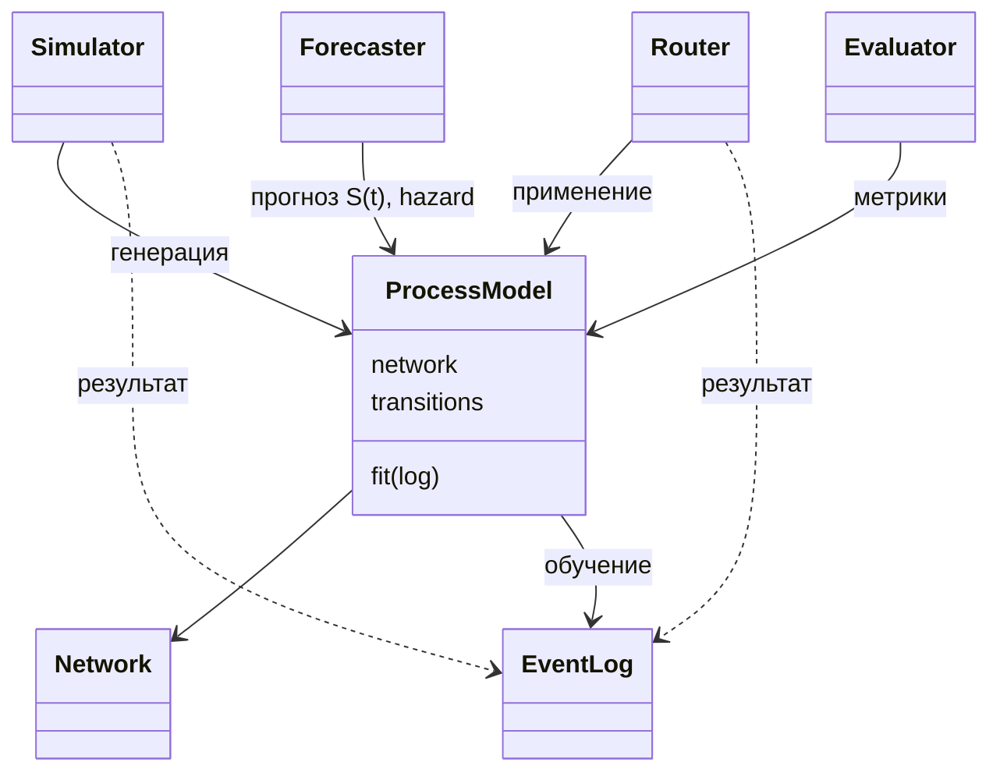

# Архитектура survpm (v2)

Библиотека соединяет Process Mining и Survival Analysis: сеть Петри задаёт структуру процесса, survival-модели — вероятности и распределения времени на рёбрах, движки — генерацию, применение и прогноз. Поддерживаемые данные: time-varying признаки, повторные события (циклы), конкурирующие риски (несколько терминальных состояний, причины цензуры).

Принцип: ядро задаёт структуры данных и протоколы (`typing.Protocol`); конкретные алгоритмы (PM4Py, семейства распределений, регрессионные модели, рендереры) — подключаемые реализации. Для каждой компоненты указана минимальная достаточная структура (атрибуты и методы); студенты реализуют варианты моделей в рамках этих контрактов.

## Каркас



Цикл «признаки на входе → независимые времена переходов → выбор минимального времени → переход и запись» принадлежит движкам. Единая `TransitionModel` задаёт и обучает совместную модель следующего направления и времени.

Направление зависимостей (одностороннее):

```
log, network  ←  models  ←  model  ←  engine  ←  viz, metrics
adapters  →  network, log   (pm4py, graphviz — extras)
```

`EventLog` и `Network` ни от чего не зависят; ядро использует только numpy/pandas/scipy.

## Модули

| Модуль | Содержимое |
|---|---|
| `log` | `EventLog`, парсинг, подготовка трасс, `intervals()`, `features_at()` |
| `network` | `Network` (структура), валидация, экспорт |
| `discovery` | протокол `PetriBackend`, функция `discover(log, backend)` |
| `adapters/pm4py` | единственное место зависимости от PM4Py (AGPL), extras |
| `models/transitions` | единая обучаемая `TransitionModel` для времени и направления перехода; семейства распределений — компоненты её реализации |
| `models/features` | построение признаков из истории (`HistoryFeatures`) и обновление X при входе (`FeatureUpdater`) |
| `model` | `ProcessModel` — композиция Network + TransitionModel |
| `engine` | `Simulator`, `Router`, `Forecaster`, `ObjectStream`, `TransitionPicker` |
| `viz` | протокол `Visualizer`, бэкенды graphviz/matplotlib |
| `metrics` | протокол `Metric`, реестр, `compare(models, log)`, структурные метрики сетей |

Реализации протоколов регистрируются по имени (`register_transition_model("weibull", WeibullTransitionModel)`); эксперименты собираются из конфигурации без импорта реализаций в ядро.

## EventLog — данные

Пассивное хранилище наблюдений (данные в покое). Состояния START/TERMINAL/CENS — конфигурация, не константы.

```python
class EventLog:
    events: DataFrame        # case_id, activity, timestamp, ...
    cases: DataFrame         # статические признаки объектов
    measurements: DataFrame  # case_id, timestamp, feature, value (time-varying)
    observation: DataFrame   # конец наблюдения, индикатор исхода, причина цензуры

    @classmethod
    def from_frame(cls, data, mapping, **parse_options) -> "EventLog": ...
    def prepare(self, rules) -> "EventLog": ...      # сортировка, обрезка до TERMINAL,
                                                     # склейка повторов, min_duration
    def intervals(self) -> DataFrame: ...            # интервалы состояний + индикатор цензуры
    def features_at(self, case_id, t, cutoff=None) -> dict: ...   # фактические данные не позже cutoff
    def split(self, method, **options) -> tuple["EventLog", "EventLog"]: ...
    def to_frame(self) -> dict[str, DataFrame]: ...
```

Правила `prepare` заменяемы; трасса без START отбрасывается; незавершённая трасса — цензурированный интервал; Для прогноза `cutoff=as_of` ограничивает фактические данные; при `t > as_of` будущие X задаются отдельным сценарием. Варианты реализации: правила подготовки трасс, парсеры источников данных.

## Network — структура процесса

Только структура: состояния, рёбра, начальные и терминальные состояния. Без вероятностей и без привязки к движку discovery; циклы допустимы (повторные события). Базовый вариант — граф состояний: одно активное состояние на объект (маркированные сети — см. «Расширения»).

```python
class Network:
    states: list[str]
    edges: DataFrame         # src, dst (+ веса)
    starts: list[str]
    terminals: list[str]

    @classmethod
    def from_edges(cls, edges, starts, terminals) -> "Network": ...
    def outgoing(self, state) -> list[str]: ...
    def validate(self) -> DataFrame: ...   # недостижимые состояния, тупики

class PetriBackend(Protocol):              # движок построения сети
    def discover(self, log: EventLog) -> Network: ...
```

```python
network = discover(train_log, backend=Pm4pyBackend(method="inductive"))
network = Network.from_edges(edges, starts=["START"], terminals=["TERMINAL"])
```

PM4Py импортируется только внутри адаптера (изоляция AGPL-зависимости от ядра). Варианты реализации: майнеры PM4Py (Inductive / Heuristics / DFG), собственные алгоритмы discovery.

## Протоколы моделей — точки расширения

Единая `TransitionModel` обучается и обновляется на данных обо всех исходящих переходах. Семейства распределений могут быть внутренними компонентами реализации, но не являются отдельно обучаемой моделью выбора. Для цензурированного наблюдения следующий исход неизвестен и учитывается совместно по возможным направлениям.

```python
class HistoryFeatures(Protocol):
    def fit(self, train_log) -> Self: ...
    def transform(self, history, as_of) -> dict: ...

class TransitionModel(Protocol):
    def fit(self, log, network, features, use_censoring=True) -> Self: ...
    def update(self, log, features) -> Self: ...
    def transition_parameters(self, state, X, history) -> dict: ...
    def log_likelihood(self, intervals, features) -> float: ...
    def next_transition(self, state, X, history, rng) -> tuple[str, float]: ...

class FeatureUpdater(Protocol):
    def __call__(self, X, state, t, rng) -> dict: ...

class TransitionPicker(Protocol):
    def pick(self, transition_times, rng) -> tuple[str, float]: ...
```

`HistoryFeatures` извлекает признаки из доступной истории: например, время в состоянии, число посещений, предыдущие события и последние значения измерений. Его настройки обучаются только на обучающих данных. `FeatureUpdater` задаёт изменение X при входе в состояние и не заменяет построение признаков из истории.

**Согласованное правило выбора:** для каждого исходящего перехода независимо генерируется время; выбирается переход с минимальным временем. `TransitionModel` задаёт распределения этих времён и рассчитывает соответствующий совместный закон направления и времени для обучения, прогноза и оценки. При независимых временах вклад наблюдённого перехода в направлении k в момент t — `f_k(t) * product(S_j(t), j != k)`; вклад правой цензуры в момент c — `product(S_j(c))`. Вероятности направлений выводятся из этого закона. Допущения о цензурировании и независимости времён должны быть указаны в реализации модели.

Встроенные реализации: семейства exponential / weibull / lognormal / gamma; тождественный `FeatureUpdater`; `MinTimePicker` для независимых времён.

**Инварианты реализаций:**

- **Batch-семантика:** везде, где принимается `X`, допустим батч (несколько объектов); скалярный выход становится вектором.
- **`fit` возвращает новый экземпляр** (`Self`); обученная модель неизменяема.
- **Чистые функции от аргументов и `rng`:** без скрытого состояния и скрытой случайности.

Генерация, прогноз и оценка используют один совместный закон `TransitionModel` с выбором по минимальному времени.

## Первая итерация — сквозной каркас и минимум времени

В первой итерации создаются интерфейсы сети, журнала, единой `TransitionModel` и движков. Выбор перехода по **минимуму независимо сгенерированных времён** реализуется сразу: для каждого исходящего ребра генерируется время, переход с минимальным временем определяет следующее состояние и длительность ожидания.

Для работающего сквозного примера параметры распределений по рёбрам можно сначала задать вручную. Семейства распределений подключаются через единый интерфейс модели переходов. Вероятности исходов и прогноз для этой модели рассчитываются из того же закона минимума; неподдерживаемые расчёты явно обозначаются как ещё не реализованные.

| Компонент | Основа первой итерации |
|---|---|
| Данные и признаки | `EventLog`, подготовка интервалов и построение признаков из истории через `HistoryFeatures`. |
| Распределения | Экспоненциальные времена исходящих переходов; параметры задаются вручную или обучаются по данным. |
| Генерация | `MinTimePicker` и цикл с обновлением X при входе в состояние. |
| Обучение | Единая `TransitionModel` с функцией правдоподобия для независимых конкурирующих времён и правой цензуры. |
| Прогноз и оценка | Расчёты согласованы с совместным законом минимума времён; реальные данные ограничены моментом `as_of`. |

## ProcessModel — композиция

```python
class ProcessModel:
    network: Network
    transitions: TransitionModel
    history_features: HistoryFeatures
    picker: TransitionPicker

    def fit(self, log, features=None, use_censoring=True) -> "ProcessModel": ...
    def transition_parameters(self, state, X, history) -> dict: ...  # распределения времён и выводимые вероятности
    def next_transition(self, state, X, history, rng) -> tuple[str, float]: ...
    def edges_table(self) -> DataFrame: ...      # диагностика обучения по рёбрам
```

Запросный интерфейс для движков: `next_transition` (стохастический шаг = `transition_parameters` + `picker.pick`) и `transition_parameters` (аналитический доступ к распределениям — для точного прогноза, диагностики, метрик). `picker` остаётся частью конфигурации модели, а `transitions` предоставляет согласованный совместный закон для генерации, прогноза и оценки. Модель не содержит `simulate/predict/evaluate` (это обязанности движков) и не хранит состояние объектов. Для генерации ground truth параметры задаются константными реализациями тех же протоколов.

## Движки

Движки взаимодействуют с моделью только через `next_transition` (стохастический шаг) и `transition_parameters` (аналитический доступ), а также публичную структуру сети (`outgoing`, `terminals`); внутренние параметры модели им недоступны. Все используемые движком функции и модели (признаки, выбор, исполнение) передаются параметрами при инициализации, а не внутри методов.

### Simulator — генерация

```python
class Simulator:
    def __init__(self, model: ProcessModel, seed=None, executor=None): ...
    def run(self, stream: ObjectStream, horizon=None, max_steps=None) -> EventLog: ...
```

Шаг цикла на активном объекте:

```python
state, X, t = stream.current(obj)
history = stream.history(obj)
dst, dt = model.next_transition(state, X, history, rng)  # единственный запрос к модели
X_new = stream.updater(X, dst, t + dt, rng)              # объект FeatureUpdater (задан при init)
log.write(obj, dst, t + dt, X_new)                       # скрытые узлы не пишутся
```

Результат: журнал (`case_id, state, timestamp, X', переход, dt`) и таблица цензуры (`end, reason`). Остановка: TERMINAL / max_steps / горизонт; список скрытых узлов — конфигурация.

### Router — применение

При воспроизведении известной истории признаки читаются из журнала на соответствующие моменты. При прогнозе на `as_of` доступны только данные не позже `as_of`; для будущих состояний X задаются сценарием или отдельной моделью признаков. X обновляется при входе в состояние, а замеры во время ожидания не пересчитывают уже выбранный переход. Результат — цепочка состояний со временем для объекта.

```python
class Router:
    def __init__(self, model: ProcessModel): ...
    def run(self, log: EventLog, case_id, as_of, future_features, horizon=None) -> DataFrame: ...
```

### Forecaster — прогноз

```python
class Forecaster:
    def __init__(self, model, history_features, method="simulation", n_paths=1000, seed=None): ...
    def survival(self, history, as_of, times, future_features) -> DataFrame: ...
    def hazard(self, history, as_of, times, future_features) -> DataFrame: ...
    def terminal_probs(self, history, as_of, times, future_features) -> DataFrame: ...
    def expected_time(self, history, as_of, future_features) -> dict[str, float]: ...
```

`history` содержит события и измерения, доступные на абсолютный момент `as_of`. `HistoryFeatures` строит признаки, в том числе время с входа в текущее состояние. Прогноз учитывает, что перехода за это время ещё не произошло. Горизонты `times` отсчитываются от `as_of`.

Реальные измерения после `as_of` при прогнозе не используются: будущие X задаются через `future_features` (фиксированный профиль, заранее известный сценарий или модель). Пересчёт X происходит при входе в состояние, а не при каждом новом замере в период ожидания. Воспроизведение полностью известной истории — отдельный режим.

`method="simulation"`: `n_paths` продолжений из текущей истории с учётом уже прошедшего ожидания. `method="exact"`: композиция переходных ядер на сетке, когда это допустимо для модели признаков и истории. Оба метода используют совместный закон `TransitionModel`. Цензурирование учитывается при обучении и оценке и не является исходом процесса.

### ObjectStream — состояние исполнения

```python
class ObjectStream:
    objects: DataFrame             # case_id, state, t, X, история
    updater: FeatureUpdater        # модель обновления признаков (может содержать прогнозную модель)

    def __init__(self, initial, updater: FeatureUpdater, seed=None): ...
    def current(self, case_id) -> tuple[str, dict, float]: ...
    def history(self, case_id): ...
```

`EventLog` — данные в покое; `ObjectStream` — изменяемое состояние исполнения, которым владеет движок. Движок записывает события потока в новый журнал, поэтому результат `Simulator` — полноценный `EventLog`.

## Визуализация и метрики

```python
class Visualizer(Protocol):                      # бэкенды: graphviz / matplotlib / web
    def plot_network(self, model) -> Figure: ...            # граф состояний с CENS
    def plot_edge_curves(self, model, edge) -> Figure: ...  # S(t), hazard, p, квантили
    def compare_km(self, model, log, edge) -> Figure: ...   # сравнение с Капланом–Майером

class Metric(Protocol):
    def __call__(self, model, log) -> DataFrame: ...
```

```python
scores = evaluate(model, test_log, metrics=["nll", "ibs"])
table  = compare([model_a, model_b], test_log, metrics=["nll"])
diff   = compare_networks(net_true, net_recovered)  # рёбра (precision/recall/F1), вероятности
```

Методы `plot` в классах ядра — делегаты к модулю `viz`. Варианты реализации: новые бэкенды рендеринга, новые метрики (регистрация по имени).

## Восстановление структуры (round-trip)

Сценарий «обучение на внешних данных → генерация → восстановление сети → сравнение» — замкнутый конвейер, потому что результат `Simulator` — полноценный `EventLog`, пригодный для discovery:

```python
model = ProcessModel(network_true, ...).fit(real_log)          # обучение на внешних данных
syn_log = Simulator(model, seed=42).run(stream)                # генерация новых данных
network_rec = discover(syn_log, backend=Pm4pyBackend())        # восстановление сети
diff = compare_networks(network_true, network_rec)             # сравнение структур
score = evaluate(ProcessModel(network_rec, ...).fit(syn_log), test_log, ...)  # и поведения
```

## Перенос на новый домен

Каркас фиксирует **инварианты** (формат журнала, цикл движков, протоколы), домен задаёт **только точки расширения**:

| Что меняется в домене | Точка расширения | Что НЕ меняется |
|---|---|---|
| Источник и структура данных | `mapping` и правила `prepare` в `EventLog` | формат журнала |
| Структура процесса | `PetriBackend` или `Network.from_edges` | `Network`, движки |
| Время и направление перехода | реализация единой `TransitionModel` | совместный закон перехода |
| Признаки из истории | реализация `HistoryFeatures` | ограничение истории моментом `as_of` |
| Динамика признаков | реализация `FeatureUpdater` | цикл движков |
| Совместный выбор (направление, время) | реализация `TransitionPicker` | согласованность расчёта и симуляции |
| Скрытое состояние | реализация `LatentModel` | поток, журнал, движки |
| Критерии качества | реализация `Metric` | `evaluate` / `compare` |

Студент в новом домене пишет 1–3 реализации протоколов и регистрирует их по имени; движки, журнал, визуализация и метрики работают без изменений. Пример: повторные события — `TransitionModel`, признаки истории (счётчики, давность) и циклы в `Network`.

## Сквозной пример

```python
log = EventLog.from_frame(df, mapping={...}).prepare(rules)
train, test = log.split(method="by_case", ratio=0.8)

network = discover(train, backend=Pm4pyBackend())
model = ProcessModel(network, transitions=transition_model, history_features=history_features).fit(train)

syn_log = Simulator(model, seed=42).run(ObjectStream(objects, updater))   # генерация
path    = Router(model).run(real_log, case_id=7, as_of=as_of, future_features=scenario)                          # применение
S       = Forecaster(model, history_features).survival(history, as_of, times=[1, 7, 30], future_features=scenario)           # прогноз
scores  = evaluate(model, test, metrics=["nll", "ibs"])                   # качество
```

## Воспроизводимость

Единственный источник случайности — `numpy.random.Generator`, создаваемый движком из `seed` и передаваемый во все протоколы (`sample`, `pick`, `update_features`, `LatentModel`). Дочерние генераторы на объект порождаются через `SeedSequence.spawn`, поэтому результат не зависит от порядка исполнения и числа воркеров. Реализации, использующие собственные источники случайности, нарушают контракт.

## Расширения

### Латентные состояния Z

```python
class LatentModel(Protocol):                   # скрытое состояние объекта
    def init(self, case_id, rng) -> Any: ...        # Z0 при создании объекта
    def update(self, Z, state, t, rng) -> Any: ...  # Z' при входе в состояние
    def infer(self, history) -> Any: ...            # оценка Z по наблюдаемой истории
```

Z хранится в `ObjectStream` и не пишется в наблюдаемый журнал. При подключённой `LatentModel` протоколы получают дополнительный опциональный аргумент `Z=None`; движки передают его без интерпретации, модель не хранит Z. На реальных данных Z оценивается через `infer(history)`. Ядро и движки не изменяются: задача со скрытым состоянием сводится к одной реализации `LatentModel`.

### Конкурирующие риски

Несколько терминальных состояний и причины цензурирования задаются конфигурацией `EventLog`. Базовая стратегия — независимые времена исходящих переходов и выбор минимального. Причина исхода и причина цензурирования — разные поля. Вероятности терминальных исходов к заданному горизонту рассчитываются из совместного закона модели.

### Маркированные сети

Базовый `Network` — граф состояний (одно активное состояние на объект). Параллелизм процесса (AND-split/join, общие ресурсы) — расширение `MarkedNetwork`: маркировка, разрешённые переходы, явная семантика конфликтов. Базовые движки от него не зависят.

### Ускорение и параллелизация

Инструменты не фиксируются; каркас фиксирует инварианты, делающие ускорение возможным без смены API:

1. Batch-семантика протоколов — векторизация шага по множеству объектов.
2. Независимость траекторий объектов — параллелизм по объектам.
3. Неизменяемость обученных моделей — разделение между воркерами без копирования.
4. Дочерние генераторы случайности на объект — детерминизм при любом числе воркеров.
5. Параметр `executor` в движках — смена стратегии исполнения без изменения моделей.
6. Кэширование `transition_parameters` с учётом состояния, X и всех используемых признаков истории.
7. Колоночное представление журнала; векторные операции на горячих путях (интервалы, as-of признаки).

## Ключевые решения

| Решение | Причина |
|---|---|
| Структура (Network) отделена от параметров (ProcessModel) | Одна сеть — много профилей поведения; ground truth |
| Цикл принадлежит движкам, не модели | Модель остаётся компактной и тестируемой; политика обхода меняется отдельно |
| Генерация и применение — разные движки | Разные источники признаков (модель vs журнал), разная семантика |
| Discovery только через адаптер | Ядро не зависит от лицензии PM4Py (AGPL) |
| Протоколы вместо базовых классов | Любая прогнозная модель подключается без наследования |
| Единый `rng` во всех протоколах + `spawn` на объект | Полная воспроизводимость по seed, в т.ч. при параллелизме |
| Синтетический журнал = полноценный EventLog | Замкнутый round-trip: генерация → discovery → сравнение сетей |
| Домен = реализации протоколов + конфигурация | Перенос на новый домен без изменений ядра и движков |
| Единая `TransitionModel` и выбор минимального времени | Согласованные обучение, прогноз и генерация для конкурирующих переходов |
| История признаков ограничена `as_of` | Исключение утечки будущих измерений |
| Расширения (Z, маркировка, ускорение) — отдельный слой | Основной каркас остаётся минимальным |
