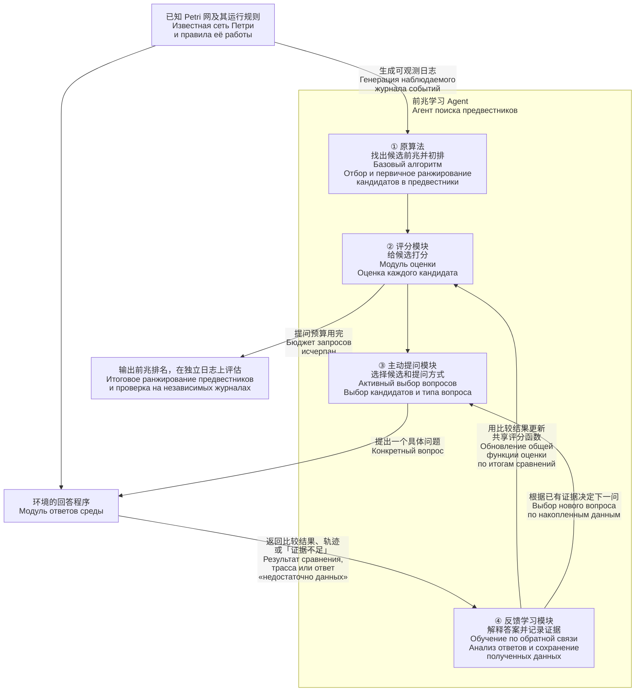
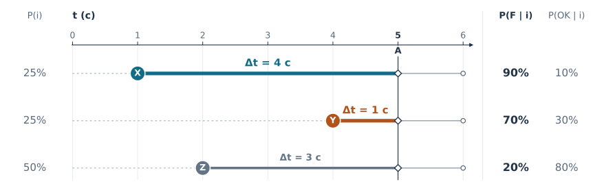

# 前兆主动学习框架 / Схема активного обучения для поиска предвестников



<a name="experiment-1"></a>

## Эксперимент 1. Как ответ среды меняет оценку предвестника отказа

### Цель эксперимента

Представим, что в журнале только что появилось событие `A`. Следующей записью может стать отказ `F` или нормальное завершение `OK`. Среди событий, наблюдаемых до `A`, алгоритм ищет возможные предвестники отказа. Мы проверяем, **может ли ответ среды на вопрос о двух событиях изменить общую функцию оценки так, чтобы изменились и оценки кандидатов, о которых агент не спрашивал**.

### Ход эксперимента

1. **Генерация журнала.** Известная сеть Петри моделирует работу машины. Каждый цикл проходит через `S → C1 → C2`, затем через одну из ветвей, `P` или `B`, и достигает `A`. Цикл заканчивается событием `F` или `OK`. В журнал попадает последовательность наблюдаемых событий и её исход.
2. **Отбор кандидатов.** По завершённым циклам базовый алгоритм находит общий якорь `A` и выдаёт начальный порядок **P, C2, C1, S**. Циклы с `B` можно использовать как контрольную группу в вопросах. Итоговый список состоит из кандидатов базового алгоритма.
3. **Запрос и обновление.** Агент выбирает два события и спрашивает, в какой группе выше риск отказа на следующем шаге после `A`. Модуль ответов вычисляет оба риска по сети и правилам выбора переходов и возвращает агенту результат сравнения. При строгом предпочтении агент обновляет общие веса, пересчитывает оценки всех кандидатов и выбирает следующий вопрос. [Базовый алгоритм](precursor-mining-simple/README.md) · [Сеть](prototype_v1/teacher-net.json) · [Модуль ответов](prototype_v1/environment.py)

### Настройки эксперимента

| Параметр | Значение |
|---|---|
| Обучающий журнал | 80 завершённых циклов, по 40 на ветви P и B. Начальное значение генератора случайных чисел — 7 |
| Правила среды | После A вероятность отказа на следующем шаге равна 30% на ветви P и 0% на ветви B |
| Базовый алгоритм | Окно истории 20 с, период полузатухания 2 с, коэффициент демпфирования PageRank 0.85. [Все параметры](precursor-mining-simple/config/example.json) |
| Выбор вопросов | Бюджет 4 сравнения риска. Каждый раз выбирается ещё не запрошенная пара с наименьшей разницей текущих оценок. Любой запрос расходует одну единицу бюджета |
| Обновление весов | Начальные веса `(1, 0)`, скорость обучения 1. При строгом предпочтении веса обновляются. Ответы «риски равны» и «недостаточно данных» записываются без обновления |

В полученном журнале на ветви P произошло 17 отказов и 23 нормальных завершения. На ветви B все 40 циклов завершились нормально. Доля отказов 17/40 (42.5%) относится к этой выборке. При ответе на запрос о риске среда использует вероятность 30%, заданную для ветви P.

### Какие вопросы задал агент

Все четыре обучающих запроса имеют одну форму. **«Обе группы уже достигли A. В первой группе до A встречалось событие X, во второй — событие Y. В какой группе выше вероятность, что следующим событием станет F?»** Группы могут пересекаться. Возможные ответы среды — «выше в первой группе», «выше во второй», «риски равны», «недостаточно данных».

| Запрос | Событие до A в первой группе | Событие до A во второй группе | Ответ среды |
|---:|---|---|---|
| 1 | C1 | C2 | Риски равны |
| 2 | C1 | S | Риски равны |
| 3 | C2 | S | Риски равны |
| 4 | B | S | Выше в группе S |

Перед обучением программа показывает заданные риски для групп P и B и отдельно демонстрирует два диагностических запроса. Все четыре единицы бюджета активного обучения приходятся на сравнения в таблице.

- **Контрпример.** «Можно ли привести цикл, который прошёл через P и сразу после A завершился нормально?» Среда возвращает траекторию `S → C1 → C2 → P → A → OK`.
- **Сопоставимость контекстов.** «Есть ли среди циклов с P как примеры с C1 перед P, так и примеры без C1 перед P?» Во всех циклах с P ранее встречается C1. Контрольной группы для оценки отдельного вклада C1 в этих циклах нет.

### Как четвёртый ответ изменил оценку P

События `S`, `C1` и `C2` встречаются в каждом цикле, поэтому первые три вопроса сопоставляют одни и те же множества циклов. В четвёртом сравнении риск в группе `B` равен нулю. Группа `S` охватывает все циклы, половина которых проходит через P. Её риск совпадает с общим риском `0.5 × 0.30 = 0.15`. Агент получает ответ «выше в группе S».

Для каждого события вычисляются два признака. Первый признак `r` — базовая оценка, нормированный PageRank. Контрольному событию B присваивается начальная оценка 0. Второй признак `d` — разность долей циклов, в которых событие встретилось до A, в группе с отказом и в группе с нормальным исходом. Событие P встретилось в 17 из 17 циклов с отказом и в 23 из 63 циклов с нормальным исходом. Поэтому для него `d = 17/17 − 23/63 ≈ 0.635`.

Общая формула — **оценка = w₁ × r + w₂ × d**. До четвёртого вопроса оценка P равнялась 0.850. После ответа веса составили `w₁ ≈ 1.0944` и `w₂ ≈ 0.2841`. С прежними признаками P получаем `1.0944 × 0.850 + 0.2841 × 0.635 ≈ 1.111` балла. **Ни одно из четырёх обучающих сравнений не касалось P. Его оценка изменилась за счёт обновления общих весов.** [Выбор пары и обновление весов](prototype_v1/agent.py) · [Веса этого запуска](prototype_v1/results/weights.json)

### Как воспроизвести

Скачайте репозиторий целиком. Команды рассчитаны на активное окружение Python 3.12 и запускаются из корня репозитория.

```bash
cd hu_yubo
python -m pip install -r precursor-mining-simple/requirements-dev.txt
python -m prototype_v1.demo --seed 7 --p 0.30 --budget 4
python -m pytest -q prototype_v1/test_prototype.py
```

Чтобы увидеть состояние перед четвёртым ответом, измените бюджет на `--budget 3`. Чтобы загрузить веса этого запуска, выполните следующую команду из каталога `hu_yubo`.

```bash
python -m prototype_v1.demo --seed 7 --load-model prototype_v1/results/weights.json
```

<a name="experiment-1-questions"></a>

### Три типа вопросов к среде

Все четыре вопроса в обучающем цикле были сравнениями риска. Поиск контрпримера и проверка контекста использовались для диагностики.

| Тип вопроса | Вопрос к среде | Ответ в эксперименте 1 | Как используется ответ |
|---|---|---|---|
| Сравнение риска | В какой группе выше риск отказа `F` сразу после `A` — в циклах с `B` до `A` или в циклах с `S` до `A`? | «Выше в группе `S`». По правилам сети риск равен 0 % в группе `B` и 15 % в группе `S`. | Агент использует результат сравнения, чтобы обновить веса общей функции оценки всех кандидатов. |
| Поиск контрпримера | Есть ли цикл, в котором до `A` встречается `P`, а сразу после `A` следует нормальное завершение `OK`? | `S → C1 → C2 → P → A → OK` | Один такой цикл опровергает предположение, что при наличии `P` после `A` обязательно произойдёт отказ. `P` всё ещё может указывать на повышенный риск. |
| Проверка контекста | Среди циклов с `P` до `A` встречаются ли оба варианта — с `C1` раньше `P` и без `C1` до `P`? | С `C1` до `P` — да. Без `C1` до `P` — нет. | Для оценки того, даёт ли `C1` дополнительную информацию о риске при наличии `P`, нужна вторая группа. В этой сети она отсутствует. |

В реальном журнале для сравнения риска можно указать по каждой группе число циклов с известным следующим событием после `A` и число отказов `F` среди них. Для проверки контекста можно посчитать циклы с `C1` до `P` и без него.

<a name="experiment-2"></a>

## Эксперимент 2. Может ли ответ сети Петри изменить ранжирование через веса рёбер?

В эксперименте 1 агент подбирал коэффициенты формулы, применяемой после расчёта PageRank. В эксперименте 2 он выбирает один параметр построения графа — период полузатухания $h$. После ответа среды алгоритм пересчитывает веса рёбер и получает итоговые оценки кандидатов из PageRank на обратном графе.

### Как временное затухание влияет на PageRank

Рассмотрим два сигнала из новой сети. Сигнал `X` появляется за 4 секунды до общего якоря `A`, а `Y` — за 1 секунду. Для каждого сигнала $i$ интервал до якоря постоянен. Вес ребра от $i$ к `A` задаётся формулой

```math
w_i(h)=b_i\,2^{-\Delta t_i/h}, \qquad \Delta t_i=t_A-t_i.
```

Коэффициент $b_i$ определяется по журналу. Он учитывает долю окон с отказом, в которых встретилось ребро, и отношение сглаженных частот ребра в окнах с отказом и в сопоставленных окнах с нормальным исходом. Для одной и той же выборки получаем

```math
w_X(h)\approx 0{,}37895\cdot 2^{-4/h}, \qquad w_Y(h)\approx 0{,}18667\cdot 2^{-1/h}.
```

В обратном графе оценка передаётся от отказа `F` к якорю `A`, а от `A` — к `X` и `Y` пропорционально весам двух рёбер. В этой сети нормированная оценка `A` равна 1, коэффициент демпфирования равен 0,85. Поэтому итоговая оценка каждого из двух кандидатов равна

```math
S_i(h)=0{,}85\,\frac{w_i(h)}{w_X(h)+w_Y(h)}, \qquad i\in\{X,Y\}.
```

| Период полузатухания | Вес X → A | Вес Y → A | PageRank X | PageRank Y | Первое место |
|---|---:|---:|---:|---:|---|
| 2 с, до вопросов | 0,0947 | 0,1320 | 0,3552 | **0,4948** | Y |
| 4 с, после ответа | 0,1895 | 0,1570 | **0,4649** | 0,3851 | X |

После ответа «риск в группе X выше» агент выбрал 4 с. Для `X` временной множитель вырос с 1/4 до 1/2, и вес ребра `X → A` удвоился. Доля, которую `A` передаёт `X`, выросла с **41,8 % до 54,7 %**. В результате `X` опередил `Y`.

### Что спрашивает агент и как выбирает период

> Среди циклов, достигших `A`, выше ли вероятность отказа `F` на следующем шаге в группе, где до `A` встретилось `U`, чем в группе, где до `A` встретилось `V`?

Модуль ответов вычисляет обе вероятности по правилам сети Петри. Агент получает **«да»**, если первый риск строго выше, **«нет»**, если он ниже или равен второму, и **«неизвестно»**, если риск хотя бы одной группы определить невозможно.

Для каждой сети использовали 80 исторических циклов, начальный период 2 с и бюджет до четырёх вопросов (`seed = 7`). Агент выбирал ещё не запрошенную пару с наименьшей разницей текущих оценок. Для трёх значений периода — **1, 2 и 4 с** — он сравнивал ранжирования, рассчитанные по одним и тем же окнам журнала. Выбиралось значение с наименьшим числом расхождений с накопленными ответами. При равенстве сохранялся текущий период, если он входил в число лучших. В подборе участвовали ответы «да» и «нет» о парах, для которых оба события имели оценку в графе.

### Исходная сеть из эксперимента 1

Все циклы проходили через `S → C1 → C2`, затем через `P` или `B` и достигали `A`. Вероятность отказа сразу после `A` равна 30 % на ветви `P` и 0 % на ветви `B`.

Агент последовательно задал четыре вопроса о риске — `C1 > C2`, `C1 > S`, `C2 > S` и `B > S`. На все четыре среда ответила «нет». Первые три вопроса сравнивали одни и те же циклы, поскольку `S`, `C1` и `C2` всегда встречались вместе. Событие `B` служило контролем и не имело оценки в графе. Все три периода дали одинаковое число расхождений. Агент сохранил **2 с**. Веса рёбер и порядок кандидатов остались прежними — **P (0,8500)**, C2 (0,2690), C1 (0,2424), S (0,2111).

### Новая сеть. Более ранний сигнал связан с более высоким риском

В каждом цикле выбирается одна из трёх ветвей. На 5-й секунде наблюдается `A`, на 6-й — отказ `F` или нормальное завершение `OK`.



Одно деление шкалы равно секунде. От `X` до вертикали `A` — **четыре деления**, от `Y` — **одно**. Слева указана вероятность выбора каждой ветви, справа — вероятности двух исходов на этой ветви.

| Ветвь | Заданная вероятность отказа сразу после A | Отказы / циклы в обучающем журнале |
|---|---:|---:|
| X | 90 % | 18/20 |
| Y | 70 % | 14/20 |
| Z | 20 % | 8/40 |

Число циклов каждого типа в обучающем журнале задано по вероятностям сети. `X` и `Y` встретились одинаково часто. При начальном периоде 2 с первое место занял более поздний сигнал `Y`.

Первый вопрос агента — **«Выше ли риск в группе X, чем в группе Y?»** Среда ответила **«да»**. При периодах 1 и 2 с PageRank ставил выше `Y`. Только при периоде 4 с выше оказался `X`. Затем агент спросил `Y > Z?` и `X > Z?` и оба раза получил «да». Контрольное событие `Z` не имело оценки в графе. Из трёх ответов на выбор периода повлиял первый.

### Проверка результата

После выбора периода из новой сети сгенерировали ещё 200 независимых циклов. Отказ произошёл в **47 из 49** циклов с `X` (95,9 %) и в **28 из 46** циклов с `Y` (60,9 %). Наблюдаемый порядок рисков совпал с итоговым порядком PageRank. Для дополнительного сравнения модели из эксперимента 1 передали те же три ответа в том же порядке на том же обучающем журнале. Её итоговый порядок остался **Y, X**.

В этой специально построенной сети одного ответа оказалось достаточно, чтобы изменить общий период полузатухания и исправить порядок **непосредственно запрошенной пары X и Y**. Поможет ли тот же параметр правильно ранжировать пары, о которых агент не спрашивал, предстоит проверить.
