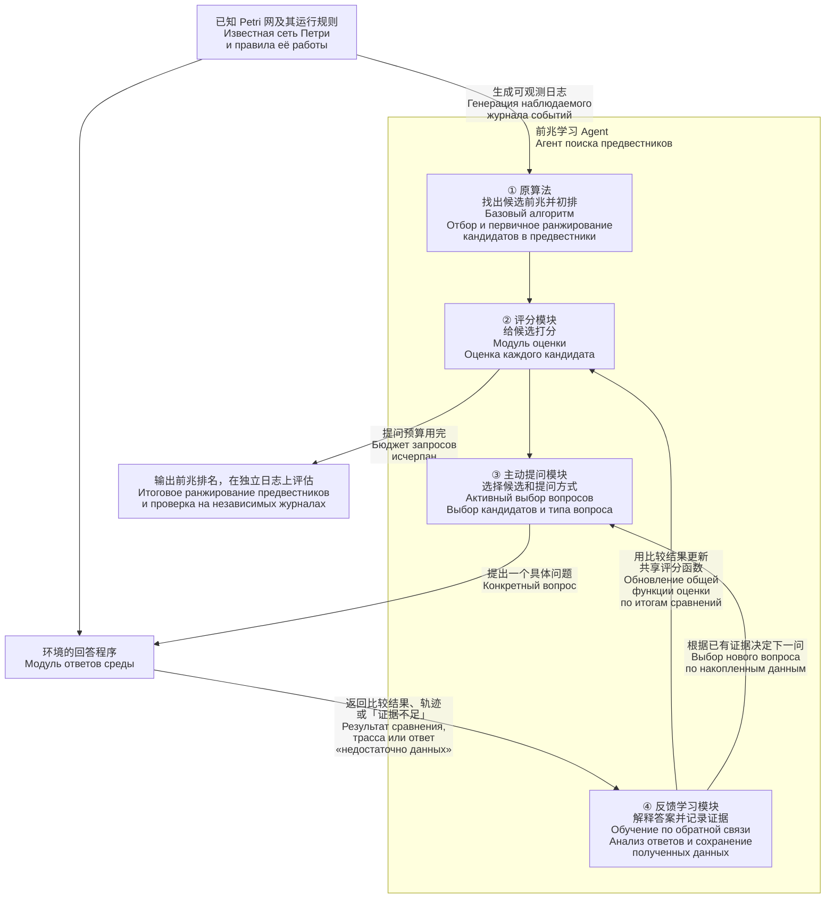

# 前兆主动学习框架 / Схема активного обучения для поиска предвестников



<a name="experiment-1"></a>

## Эксперимент 1. Как ответ среды меняет оценку предвестника отказа

### Цель эксперимента

Представим, что в журнале только что появилось событие `A`. Следующей записью может стать отказ `F` или нормальное завершение `OK`. Среди событий, наблюдаемых до `A`, алгоритм ищет возможные предвестники отказа. Мы проверяем, **может ли ответ среды на вопрос о двух событиях изменить общую функцию оценки так, чтобы изменились и оценки кандидатов, о которых агент не спрашивал**.

### Ход эксперимента

1. **Генерация журнала.** Известная сеть Петри моделирует работу машины. Каждый цикл проходит через `S → C1 → C2`, затем через одну из ветвей, `P` или `B`, и достигает `A`. Цикл заканчивается событием `F` или `OK`. В журнал попадает последовательность наблюдаемых событий и её исход.
2. **Отбор кандидатов.** По завершённым циклам базовый алгоритм находит общий якорь `A` и выдаёт начальный порядок **P, C2, C1, S**. Циклы с `B` можно использовать как контрольную группу в вопросах. Итоговый список состоит из кандидатов базового алгоритма.
3. **Запрос и обновление.** Агент выбирает два события и спрашивает, в какой группе выше риск отказа на следующем шаге после `A`. Модуль ответов вычисляет оба риска по сети и правилам выбора переходов и возвращает агенту результат сравнения. При строгом предпочтении агент обновляет общие веса, пересчитывает оценки всех кандидатов и выбирает следующий вопрос. [Базовый алгоритм](precursor-mining-simple/README.md) · [Сеть](prototype_v1/teacher-net.json) · [Модуль ответов](prototype_v1/environment.py)

### Настройки эксперимента

| Параметр | Значение |
|---|---|
| Обучающий журнал | 80 завершённых циклов, по 40 на ветви P и B. Начальное значение генератора случайных чисел — 7 |
| Правила среды | После A вероятность отказа на следующем шаге равна 30% на ветви P и 0% на ветви B |
| Базовый алгоритм | Окно истории 20 с, период полузатухания 2 с, коэффициент демпфирования PageRank 0.85. [Все параметры](precursor-mining-simple/config/example.json) |
| Выбор вопросов | Бюджет 4 сравнения риска. Каждый раз выбирается ещё не запрошенная пара с наименьшей разницей текущих оценок. Любой запрос расходует одну единицу бюджета |
| Обновление весов | Начальные веса `(1, 0)`, скорость обучения 1. При строгом предпочтении веса обновляются. Ответы «риски равны» и «недостаточно данных» записываются без обновления |

В полученном журнале на ветви P произошло 17 отказов и 23 нормальных завершения. На ветви B все 40 циклов завершились нормально. Доля отказов 17/40 (42.5%) относится к этой выборке. При ответе на запрос о риске среда использует вероятность 30%, заданную для ветви P.

### Какие вопросы задал агент

Все четыре обучающих запроса имеют одну форму. **«Обе группы уже достигли A. В первой группе до A встречалось событие X, во второй — событие Y. В какой группе выше вероятность, что следующим событием станет F?»** Группы могут пересекаться. Возможные ответы среды — «выше в первой группе», «выше во второй», «риски равны», «недостаточно данных».

| Запрос | Событие до A в первой группе | Событие до A во второй группе | Ответ среды |
|---:|---|---|---|
| 1 | C1 | C2 | Риски равны |
| 2 | C1 | S | Риски равны |
| 3 | C2 | S | Риски равны |
| 4 | B | S | Выше в группе S |

Перед обучением программа показывает заданные риски для групп P и B и отдельно демонстрирует два диагностических запроса. Все четыре единицы бюджета активного обучения приходятся на сравнения в таблице.

- **Контрпример.** «Можно ли привести цикл, который прошёл через P и сразу после A завершился нормально?» Среда возвращает траекторию `S → C1 → C2 → P → A → OK`.
- **Сопоставимость контекстов.** «Есть ли среди циклов с P как примеры с C1 перед P, так и примеры без C1 перед P?» Во всех циклах с P ранее встречается C1. Контрольной группы для оценки отдельного вклада C1 в этих циклах нет.

### Как четвёртый ответ изменил оценку P

События `S`, `C1` и `C2` встречаются в каждом цикле, поэтому первые три вопроса сопоставляют одни и те же множества циклов. В четвёртом сравнении риск в группе `B` равен нулю. Группа `S` охватывает все циклы, половина которых проходит через P. Её риск совпадает с общим риском `0.5 × 0.30 = 0.15`. Агент получает ответ «выше в группе S».

Для каждого события вычисляются два признака. Первый признак `r` — базовая оценка, нормированный PageRank. Контрольному событию B присваивается начальная оценка 0. Второй признак `d` — разность долей циклов, в которых событие встретилось до A, в группе с отказом и в группе с нормальным исходом. Событие P встретилось в 17 из 17 циклов с отказом и в 23 из 63 циклов с нормальным исходом. Поэтому для него `d = 17/17 − 23/63 ≈ 0.635`.

Общая формула — **оценка = w₁ × r + w₂ × d**. До четвёртого вопроса оценка P равнялась 0.850. После ответа веса составили `w₁ ≈ 1.0944` и `w₂ ≈ 0.2841`. С прежними признаками P получаем `1.0944 × 0.850 + 0.2841 × 0.635 ≈ 1.111` балла. **Ни одно из четырёх обучающих сравнений не касалось P. Его оценка изменилась за счёт обновления общих весов.** [Выбор пары и обновление весов](prototype_v1/agent.py) · [Веса этого запуска](prototype_v1/results/weights.json)

### Как воспроизвести

Скачайте репозиторий целиком. Команды рассчитаны на активное окружение Python 3.12 и запускаются из корня репозитория.

```bash
cd hu_yubo
python -m pip install -r precursor-mining-simple/requirements-dev.txt
python -m prototype_v1.demo --seed 7 --p 0.30 --budget 4
python -m pytest -q prototype_v1/test_prototype.py
```

Чтобы увидеть состояние перед четвёртым ответом, измените бюджет на `--budget 3`. Чтобы загрузить веса этого запуска, выполните следующую команду из каталога `hu_yubo`.

```bash
python -m prototype_v1.demo --seed 7 --load-model prototype_v1/results/weights.json
```
